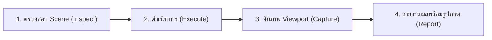

# 🎨 Blender Asset Prep MCP & Slash Command Bridge (`/blender`)

> **สะพานเชื่อมต่ออัจฉริยะระหว่าง AI Assistant (Google Antigravity, Claude Desktop, Cursor) กับโปรแกรม Blender (4.2+ / 5.x LTS)**  
> รองรับการตรวจสอบ จัดการ สร้างโมเดล 3D เตรียม Asset สำหรับเกม และถ่ายภาพ Viewport Snapshot ยืนยันผลลัพธ์แบบเรียลไทม์ผ่าน Model Context Protocol (MCP) และคำสั่งลัด `/blender`

---

## 📌 จุดเด่นและความสามารถ (Key Features)

- ⚡ **One-Click Setup ครบวงจร**: รัน `install_for_agy.bat` เพียงคลิกเดียว ติดตั้งทั้ง Blender Add-on, เซิร์ฟเวอร์ MCP และคำสั่ง Slash Command `/blender` ให้พร้อมใช้งานทันที
- 🤖 **รองรับ Slash Command `/blender`**: พิมพ์ `/blender` ในช่องแชทของ Google Antigravity เพื่อเรียกใช้งาน Agent ผู้เชี่ยวชาญด้าน 3D และ Blender โดยเฉพาะ
- 📸 **Visual Feedback Loop (Viewport Snapshot)**: ถ่ายภาพ OpenGL Snapshot จากหน้าจอ 3D Viewport ใน Blender (ความเร็วเฉลี่ย ~30ms) หรือเรนเดอร์แบบ Eevee แล้วฝังรูปภาพลงในแชทให้ตรวจสอบได้ทันที
- 🛠️ **ตรวจสอบและคลีน Mesh (Topology & Cleanup)**: ตรวจสอบความสมบูรณ์ของโครงสร้างโพลีกอน (Non-manifold, Watertight, Loose Vertices), ลบจุดซ้ำ (Merge by Distance) และคำนวณ Normals ใหม่อัตโนมัติ
- 🎯 **มาตรฐาน Game Asset Preparation**: ปรับ Apply Rotation & Scale และย้ายจุด Pivot/Origin ไปที่กึ่งกลางฐานล่าง (`set_origin_to_bottom`) โดยตำแหน่งพิกัดของวัตถุใน World-Space ไม่คลาดเคลื่อน
- 🧱 **สร้างวัตถุและจัดการ Material**: สั่งสร้าง Primitive (Cube, Sphere, Cylinder, Plane, Cone, Torus), จัดสายลำดับขั้น Parent/Child และสร้าง/กำหนด Principled BSDF Material ได้ผ่านข้อความ
- 🔒 **ปลอดภัยและเสถียร (Zero External Deps ใน Blender)**: ทำงานบน Localhost `127.0.0.1:9876` เท่านั้น ใช้ Thread-safe Dispatcher ส่งคำสั่งเข้า Main Event Loop ของ Blender ป้องกันโปรแกรมค้างหรือ Crash

---

## 🏗️ โครงสร้างสถาปัตยกรรม (Architecture)

```
[ Antigravity Chat / CLI / Claude ]
                │
                │  JSON-RPC (stdio) via /blender & MCP Tools
                ▼
      [ MCP Server Process ] (.venv)
                │
                │  HTTP POST (JSON) to 127.0.0.1:9876
                ▼
   [ Blender Add-on Bridge Server ]
                │
                │  Thread-safe Timer Queue (bpy.app.timers)
                ▼
  [ Blender 4.2+ / 5.x Engine & 3D Scene ]
```

---

## 🚀 วิธีการติดตั้ง (Installation)

### วิธีที่ 1: ติดตั้งอัตโนมัติคลิกเดียว (แนะนำสำหรับ Google Antigravity บน Windows)

เพียงรันไฟล์ตัวติดตั้งที่เตรียมไว้:

1. ดับเบิ้ลคลิกที่ไฟล์ **`install_for_agy.bat`** (หรือรันผ่าน PowerShell: `.\install_for_agy.bat`)
2. ตัวติดตั้งจะดำเนินการให้อัตโนมัติทั้งหมด 4 ขั้นตอน:
   - ตรวจสอบและสร้าง Python Virtual Environment (`.venv`) พร้อมลง dependencies ให้ครบถ้วน
   - ติดตั้ง Blender Add-on ไปยังโฟลเดอร์ส่วนเสริมของ Blender (รองรับทั้ง Blender 4.2, 5.0, 5.2+ LTS)
   - ลงทะเบียน MCP Server `blender-asset-prep` ไปยังการตั้งค่าของ Antigravity ทั้งระบบ (`mcp_config.json`, `settings.json`, `antigravity-cli`)
   - ติดตั้งและเปิดใช้งานคำสั่ง Slash Command **`/blender`** ทั้งระดับ Global (`~/.agents/skills/blender/`) และ Workspace
3. เปิดโปรแกรม Blender ไปที่ **Edit > Preferences > Add-ons** ตรวจสอบว่าเปิดติ๊กถูก **"Blender Asset Prep MCP Bridge"** เรียบร้อยแล้ว (เซิร์ฟเวอร์จะเปิดทำงานอัตโนมัติที่พอร์ต 9876)

---

### วิธีที่ 2: ติดตั้งด้วยตัวเอง (Manual Installation สำหรับ macOS, Linux, หรือ Claude Desktop)

#### 1. ติดตั้ง Dependencies และ Environment
```bash
git clone https://github.com/your-username/MCP-Blender.git
cd MCP-Blender

# สร้างและเปิด virtual environment
python -m venv .venv

# Windows:
.\.venv\Scripts\activate
# macOS / Linux:
source .venv/bin/activate

# ติดตั้ง package
pip install -e .
```

#### 2. ติดตั้ง Add-on ใน Blender
- **วิธีง่าย**: เปิด Blender > Edit > Preferences > Add-ons (หรือ Get Extensions > Install from Disk) แล้วเลือกไฟล์ `blender_asset_prep_addon.zip` ที่อยู่ในโฟลเดอร์โปรเจกต์
- **วิธีคัดลอกโฟลเดอร์**: คัดลอกโฟลเดอร์ `blender_addon/` ไปวางที่โฟลเดอร์ Add-ons ของ Blender โดยตั้งชื่อโฟลเดอร์ปลายทางเป็น `blender_asset_prep`

#### 3. ตั้งค่าใน MCP Client
เพิ่มการตั้งค่านี้ในไฟล์คอนฟิกของคุณ เช่น `claude_desktop_config.json` หรือ `mcp_config.json`:
```json
{
  "mcpServers": {
    "blender-asset-prep": {
      "command": "A:/ส่วนเสริมเขียนเอง/MCP-Blender/.venv/Scripts/python.exe",
      "args": ["-m", "mcp_server.server"],
      "env": {
        "PYTHONPATH": "A:/ส่วนเสริมเขียนเอง/MCP-Blender",
        "PYTHONIOENCODING": "utf-8"
      }
    }
  }
}
```
*(หมายเหตุ: ปรับ Path ของ Python และ PYTHONPATH ให้ตรงกับเครื่องของคุณ)*

---

## 💬 วิธีการสั่งงานผ่าน `/blender`

เมื่อเปิดใช้งานใน Antigravity คุณสามารถพิมพ์คำสั่งขึ้นต้นด้วย **`/blender`** ในช่องแชทได้ทันที โดยระบบจะทำงานตาม Loop อัตโนมัติ 4 ขั้นตอน:



### ตัวอย่างการสั่งงาน:
- `/blender สร้าง primitive cube ขนาด 2 เมตร พร้อม material สีทองเมทัลลิก แล้วถ่ายรูป Viewport`
- `/blender ตรวจสอบโมเดลทั้งหมดใน Scene ว่ามี non-manifold หรือ ngons หรือไม่`
- `/blender ทำการ freeze transforms และตั้ง pivot point ให้อยู่กึ่งกลางฐานล่างของโมเดลทุกตัว`
- `/blender สร้างป่าขนาดย่อมด้วย Cone และ Cylinder แล้วจัดกรุ๊ป parent เข้าด้วยกัน`

---

## 🧰 รายการเครื่องมือ MCP ที่พร้อมใช้งาน (Available Tools)

### 1. Scene & Collection Inspection (อ่านข้อมูล Scene)
| เครื่องมือ | คำอธิบาย | พารามิเตอร์ |
|---|---|---|
| `get_blender_status` | ตรวจสอบสถานะการเชื่อมต่อ, เวอร์ชั่น Blender, ชื่อ Scene และจำนวนวัตถุ | ไม่มี |
| `list_scene_objects` | แสดงรายชื่อวัตถุ ตำแหน่ง Rotation Scale ประเภท และรองรับ pagination | `limit: int = 100`, `offset: int = 0` |
| `get_object_details` | ดึงข้อมูลเชิงลึก: ขนาด dimensions, bounding box, parent, material slot | `object_name: str` |
| `list_scene_collections` | แสดงโครงสร้างต้นไม้ของ Collections และวัตถุในแต่ละกลุ่ม | ไม่มี |

### 2. Mesh Validation & Inspection (ตรวจสอบโครงสร้างโมเดล)
| เครื่องมือ | คำอธิบาย | พารามิเตอร์ |
|---|---|---|
| `inspect_mesh` | ตรวจสอบ Topology: watertight, non-manifold edges/vertices, loose geometry, ngons | `object_name: str` |
| `batch_inspect_mesh` | ตรวจสอบ Topology สำหรับวัตถุหลายชิ้นพร้อมกันในคำสั่งเดียว | `object_names: list[str]` |

### 3. Mesh Modeling & Asset Preparation (ปรับแต่งและเตรียม Asset)
| เครื่องมือ | คำอธิบาย | พารามิเตอร์ |
|---|---|---|
| `create_primitive` | สร้างรูปทรงพื้นฐาน: `CUBE`, `SPHERE`, `CYLINDER`, `PLANE`, `CONE`, `TORUS` | `primitive_type: str`, `name: Optional[str]`, `location: list[float]`, `size: float` |
| `apply_transforms` | ทำ Freeze Transforms (Location, Rotation, Scale) เข้าเนื้อโมเดล | `object_name: str`, `location: bool`, `rotation: bool`, `scale: bool` |
| `set_origin_to_bottom` | ย้ายจุด Origin ไปที่จุดกึ่งกลางฐานล่าง โดยตำแหน่งโมเดลใน World ไม่ขยับ | `object_name: str` |
| `clean_mesh` | รวมจุดยอดที่ซ้อนทับกัน (Merge Duplicates) และกลับด้าน Face Normal ให้ถูกต้อง | `object_name: str`, `merge_distance: float = 0.0001`, `recalculate_normals: bool = True` |
| `batch_set_origin_to_bottom` | ย้ายจุด Origin ไปที่ฐานล่างสำหรับหลายวัตถุพร้อมกัน (มี Error Isolation) | `object_names: list[str]` |
| `batch_clean_mesh` | ทำความสะอาด Mesh สำหรับหลายวัตถุพร้อมกัน | `object_names: list[str]`, `merge_distance: float`, `recalculate_normals: bool` |
| `set_object_parent` | จัดสายสัมพันธ์ Parent/Child โดยรักษาระยะพิกัดในโลกจริงไว้ | `child_name: str`, `parent_name: Optional[str]` |
| `create_material` | สร้าง Principled BSDF Material พร้อมกำหนด Base Color, Roughness, Metallic | `material_name: str`, `base_color: list[float]`, `roughness: float`, `metallic: float` |
| `assign_material` | กำหนด Material ให้กับวัตถุตามช่อง Slot | `object_name: str`, `material_name: str`, `slot_index: int = 0` |
| `delete_object` | ลบวัตถุที่ไม่ต้องการออกจาก Scene | `object_name: str` |

### 4. Visual Verification (จับภาพหน้าจอ Viewport)
| เครื่องมือ | คำอธิบาย | พารามิเตอร์ |
|---|---|---|
| `capture_viewport` | จับภาพหน้าจอ 3D Viewport แบบเรียลไทม์ (~30ms) หรือเรนเดอร์แบบสมบูรณ์ | `camera_view: bool = False`, `width: int = 800`, `height: int = 600`, `full_render: bool = False` |

---

## 🧪 การทดสอบระบบ (Testing & Verification)

โปรเจกต์นี้มีชุดทดสอบอัตโนมัติครบ 75 รายการ (Unit tests, Bridge tests, Dispatcher tests, และ Live stdio JSON-RPC):

```powershell
# รันชุดทดสอบทั้งหมด
.\.venv\Scripts\pytest -v tests/
```

ทดสอบการเชื่อมต่อตรงไปยัง Blender Bridge:
```powershell
.\.venv\Scripts\python.exe -c "import urllib.request, json; print(json.loads(urllib.request.urlopen('http://127.0.0.1:9876/health').read()))"
```
ผลลัพธ์ที่ถูกต้อง:
```json
{"status": "ok", "blender_version": "5.2.2 LTS", "api_version": "1.0.0"}
```

---

## ❓ การแก้ไขปัญหาเบื้องต้น (Troubleshooting)

| ปัญหา | สาเหตุ | วิธีแก้ไข |
|---|---|---|
| `connected: false` | Blender ยังไม่ได้เปิด หรือยังไม่ได้เปิด Add-on | เปิด Blender แล้วตรวจสอบว่าเปิดติ๊กถูกที่ส่วนเสริม "Blender Asset Prep MCP Bridge" ใน Preferences |
| Connection refused (`10061`) | เซิร์ฟเวอร์ใน Blender หยุดทำงาน | ในหน้าต่าง 3D Viewport กดปุ่ม `N` เปิดแถบข้าง > เลือกแท็บ `Asset Prep MCP` > กดปุ่ม `Start Server` |
| Port `9876` ชนกับโปรแกรมอื่น | มีโปรแกรมอื่นใช้งานพอร์ต 9876 อยู่ | ตรวจสอบด้วยคำสั่ง `Get-NetTCPConnection -LocalPort 9876` ใน PowerShell |
| สั่ง Clean mesh ไม่ได้ | วัตถุที่เลือกไม่ใช่ Mesh (เช่น Camera, Light) | เครื่องมือเกี่ยวกับ Mesh รองรับเฉพาะประเภท `MESH` เท่านั้น หรือใช้ฟังก์ชัน `batch_` เพื่อข้ามวัตถุอื่นให้อัตโนมัติ |
